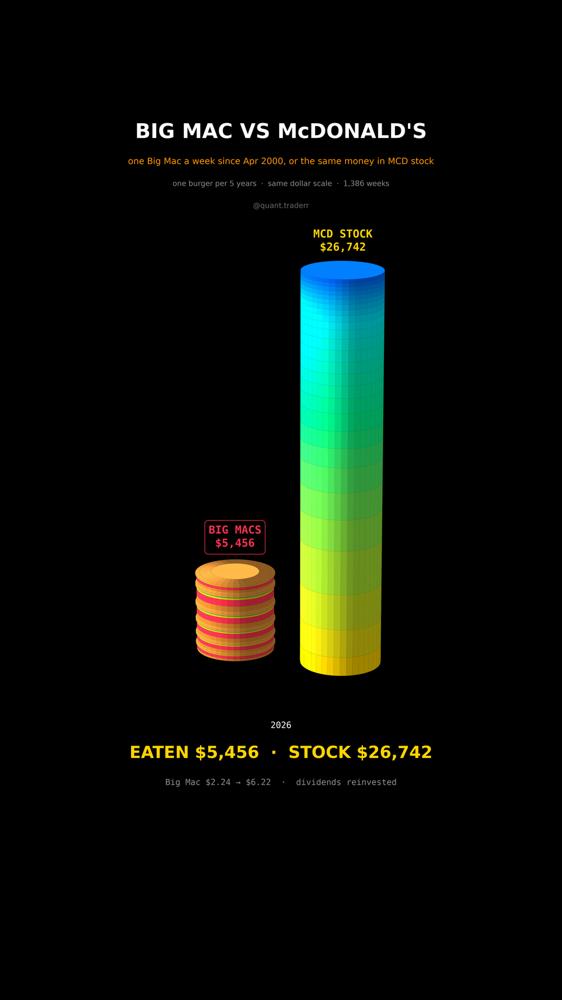

# Big Mac vs McDonald's

One Big Mac every week since Apr 2000 at the real US price, against the same
dollars put into McDonald's stock (MCD) every week instead. 1,386 weeks to
Oct 2026.



## What it measures

```
price_w  = latest US Big Mac price on or before week w   (The Economist, Big Mac index)
shares_w = price_w / MCD_w                                (Friday close, dividends reinvested)
paid     = sum price_w          worth = sum shares_w * MCD_today
```

Big Mac prices come from The Economist's public
[big-mac-data](https://github.com/TheEconomist/big-mac-data) repository
(`output-data/big-mac-full-index.csv`, `local_price` for USA).

In 3D: two towers on one linear dollar scale. Left, a stack of burgers, one per
five years, as thick as the money spent on Big Macs in those years. Right, a
stack of discs, one per year, as thick as that year's burger money is worth
today in MCD.

## What came out

| Figure | Value |
|---|---|
| Spent on Big Macs | $5,456 |
| Same money in MCD, Oct 2026 | $26,742 (4.9x) |
| Big Mac price | $2.24 to $6.22 (2.8x) |
| Year 2000 alone | $87 of burgers, $1,279 in MCD today |

## What this is not

Not advice to stop eating. Food is not an investment, and hindsight picks a
stock that did well. The Economist samples one US price once or twice a year,
so the real price you paid varied by city and month. No taxes or trading costs;
fractional weekly buys are assumed.

## Run it

```bash
cd ..
uv venv .venv --python 3.12
uv pip install --python .venv/bin/python -r requirements.txt
cd big-mac-vs-mcdonalds

../.venv/bin/python BigMacTower_Reel_Pipeline.py --smoke
../.venv/bin/python BigMacTower_Reel_Pipeline.py
../.venv/bin/python BigMacTower_Static_Pipeline.py
../.venv/bin/python BigMacTower_Caption.py
```
