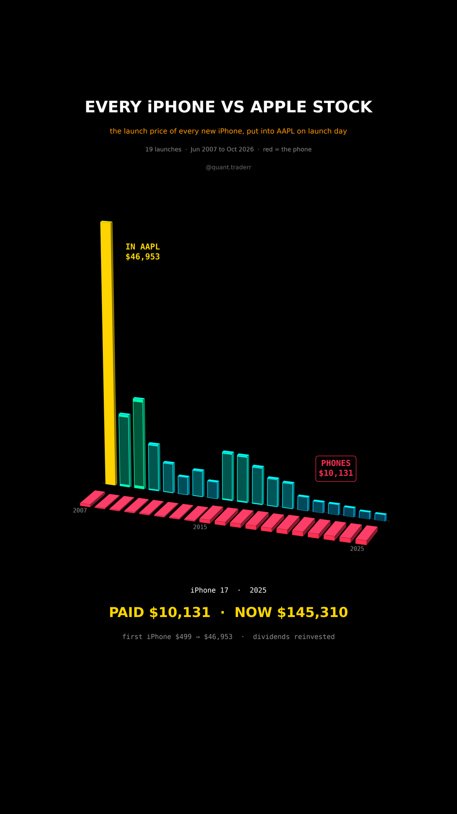

# Every iPhone vs Apple Stock

The US launch price of every standard iPhone from 2007 to 2025, 19 launches,
put into AAPL on launch day instead. Valued at the Oct 2026 close, dividends
reinvested.



## What it measures

```
worth_i = price_i * Close_today / Close_(first trading day >= launch_i)
spent   = sum price_i      worth = sum worth_i
```

AAPL daily closes from Yahoo, adjusted for splits and dividends. Launch dates
and prices are typed in from Apple's announcements (`LAUNCHES` in the
pipeline). Until the iPhone 6 Apple quoted $199 on a two-year contract; from
the 6s (2015) on it quoted the full price.

In 3D: a row of standing phone-shaped slabs, each as tall as its launch price
is worth today in AAPL. In front of each, the phone you bought lies flat and
red, as thick as the price paid, on the same linear scale.

## What came out

| Figure | Value |
|---|---|
| Paid for 19 iPhones | $10,131 |
| Same dollars in AAPL today | $145,310 (14.3x) |
| First iPhone, $499 in AAPL | $46,953 (94x) |
| iPhone 17 money (Sep 2025) | $1,122 |

## What this is not

Not advice to skip the phone. It is hindsight on one of the best stocks of the
century. The pre-2015 contract prices understate what those phones really cost,
so the stock side would be larger still. One phone per launch is a heavier
upgrade habit than most people have. No taxes or trading costs.

## Run it

```bash
cd ..
uv venv .venv --python 3.12
uv pip install --python .venv/bin/python -r requirements.txt
cd every-iphone-vs-apple-stock

../.venv/bin/python IphoneVsApple_Reel_Pipeline.py --smoke
../.venv/bin/python IphoneVsApple_Reel_Pipeline.py
../.venv/bin/python IphoneVsApple_Static_Pipeline.py
../.venv/bin/python IphoneVsApple_Caption.py
```
