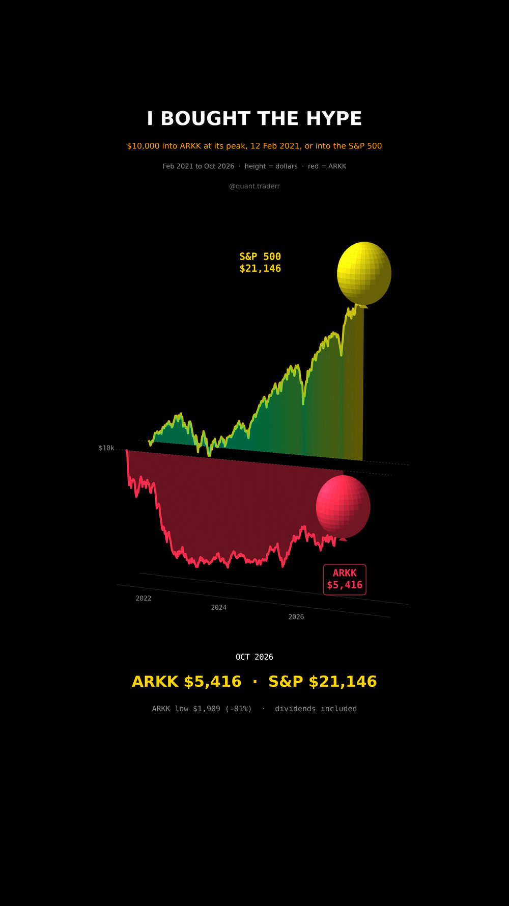

# I Bought the Hype

$10,000 into ARK Innovation (ARKK) at its all-time closing high on 12 Feb 2021,
and $10,000 into the S&P 500 (SPY) the same day. Both run to Oct 2026.



## What it measures

```
value_t = 10,000 * Close_t / Close_12Feb2021      ARKK and SPY, adjusted for distributions
```

The pipeline asserts that 12 Feb 2021 really is ARKK's highest close.

In 3D: two balloons released together at $10,000. Each drifts right with time,
floats at its dollar value and trails its string along the exact path, with a
filled sail between the path and the $10,000 line. ARKK is red.

## What came out

| Figure | Value |
|---|---|
| ARKK, Oct 2026 | $5,416 (-46%) |
| ARKK, low (Dec 2022) | $1,909 (-81%) |
| S&P 500 (SPY), Oct 2026 | $21,146 (+111%) |
| SPY over ARKK | 3.9x |
| ARKK in 2020, before the entry | +150% |

## What this is not

Not a verdict on ARKK over its whole life: it ran +150% in 2020, and earlier
buyers did fine. The entry day is picked at the top on purpose, because that is
when the hype and the inflows peaked, but one entry day is still one entry day.

## Run it

```bash
cd ..
uv venv .venv --python 3.12
uv pip install --python .venv/bin/python -r requirements.txt
cd i-bought-the-hype

../.venv/bin/python HypeBalloon_Reel_Pipeline.py --smoke
../.venv/bin/python HypeBalloon_Reel_Pipeline.py
../.venv/bin/python HypeBalloon_Static_Pipeline.py
../.venv/bin/python HypeBalloon_Caption.py
```
