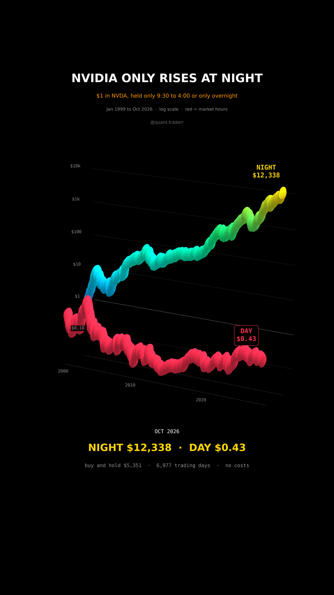

# Nvidia Only Rises at Night

Every NVDA trading day since the IPO, split in two: market hours (open to close)
and overnight (close to the next open). $1 rides each session on its own,
Jan 1999 to Oct 2026.



## What it measures

```
day_t    = prod  Close_s / Open_s          market hours, 9:30 to 4:00
night_t  = prod  Open_s / Close_(s-1)      overnight, 4:00 to 9:30
hold_t   = day_t * night_t = Close_t / Open_first
```

Yahoo daily Open and Close, adjusted for splits and dividends, 6,977 trading days.

In 3D: two pipes running through time on a log10 dollar scale. The red pipe is
market hours, the other is overnight, coloured by its own height.

## What came out

| Figure | Value |
|---|---|
| $1, market hours only | $0.43 (-57%) |
| $1, overnight only | $12,338 |
| $1, buy and hold | $5,351 |
| Market hours, worst point | $0.07 |

## What this is not

Not a strategy. Buying every close and selling every open pays the spread and
commission twice a day for almost 7,000 days, which eats the edge. The night
carries the earnings gaps and the news risk that day traders avoid. It is one
stock, the best performer of its era, so the sizes are extreme; the same split
on SPY is much milder. The official open is not a price anyone was guaranteed.

## Run it

```bash
cd ..
uv venv .venv --python 3.12
uv pip install --python .venv/bin/python -r requirements.txt
cd nvidia-only-rises-at-night

../.venv/bin/python NvidiaNight_Reel_Pipeline.py --smoke
../.venv/bin/python NvidiaNight_Reel_Pipeline.py
../.venv/bin/python NvidiaNight_Static_Pipeline.py
../.venv/bin/python NvidiaNight_Caption.py
```
