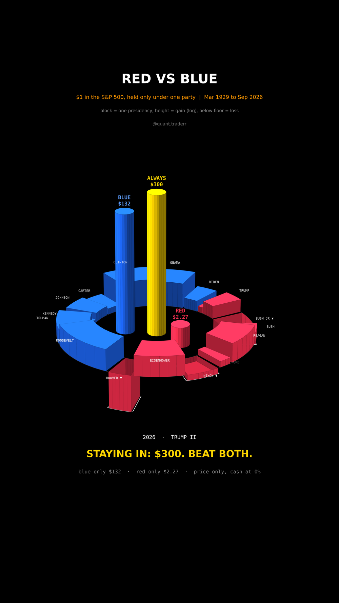

# Red vs Blue

$1 in the S&P 500 held only while one party is in the White House, cash the
rest of the time, against $1 that never moves. Mar 1929 to Sep 2026,
17 presidencies.



## What it measures

```
m_k        = SPX(end of term k) / SPX(start of term k)      price index
always     = product of every m_k  = SPX(end) / SPX(Mar 1929)
blue only  = product of m_k over Democratic presidencies, cash at 0% otherwise
red only   = product of m_k over Republican presidencies, cash at 0% otherwise
```

`validate()` checks that the two party products multiply back to `always`, so
no day is counted twice or dropped between terms.

In 3D: an arena. Each presidency is a curved block on a ring, its arc length
is its time in office and its height is log10(m_k): blocks that rise gained,
blocks that sink below the floor lost. Democrats fill the left half,
Republicans the right, both in time order from the front of the ring to the
back. Three columns in the middle compound the dollars on the same log scale.

## What came out

| Figure | Value |
|---|---|
| Always invested | $300 |
| Blue only | $132 |
| Red only | $2.27 |
| Red only without Hoover | $9.92 |
| Hoover, 1929 to 1933 | -77% |
| Terms that lost | Hoover, Nixon, Bush Jr |

## What this is not

Not a claim that presidents move markets. Red only is dragged down mostly by
one crash, 1929 to 1933 under Hoover; start the clock in 1933 and the gap
between the parties shrinks a lot. 17 presidencies is a tiny sample. Congress,
the Fed and wars are ignored. Dividends are left out (they would lift every
line) and cash earns 0%, which is harsh on both party-only dollars.

## Run it

```bash
cd ..
uv venv .venv --python 3.12
uv pip install --python .venv/bin/python -r requirements.txt
cd red-vs-blue

../.venv/bin/python RedVsBlue_Reel_Pipeline.py --smoke
../.venv/bin/python RedVsBlue_Reel_Pipeline.py
../.venv/bin/python RedVsBlue_Static_Pipeline.py
../.venv/bin/python RedVsBlue_Caption.py
```
