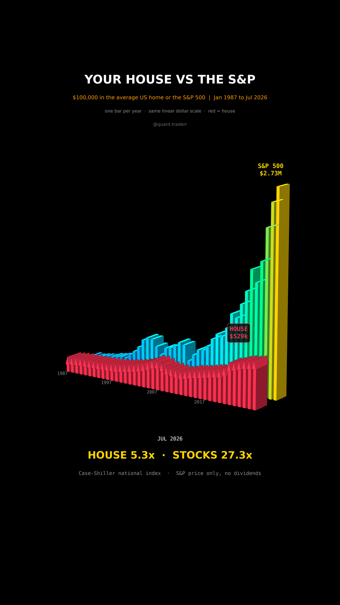

# Your House vs the S&P

$100,000 into the average US home in Jan 1987 and $100,000 into the S&P 500
the same month, both run to Jul 2026, the latest month of the home price index.



## What it measures

```
house_t  = 100,000 * HPI_t / HPI_Jan1987      Case-Shiller U.S. National, NSA (FRED CSUSHPINSA)
stocks_t = 100,000 * SPX_t / SPX_Jan1987      ^GSPC month-end close, price only
```

One bar per January from 1987 to 2026, plus Jul 2026.

In 3D: a street. The front row is red houses, one per year, a box with a gable
roof whose eaves sit at the house value. The back row is towers whose roofs sit
at the stock value. Both rows share one linear dollar scale, so the gap you see
is the real gap, not a log trick.

## What came out

| Figure | Value |
|---|---|
| House, Jul 2026 | $529,257 (5.3x) |
| S&P 500, Jul 2026 | $2,732,677 (27.3x) |
| Stocks over house | 5.2x |
| Worst slump, house / stocks | -27% / -53% |

## What this is not

Not a verdict on owning a home. A house is also a place to live, so it saves
rent, and it is almost always bought with a mortgage, so a 20% down payment
carries the whole price gain; neither is in these bars. Nor are property tax,
upkeep, insurance and transaction costs, which cut the house the other way, or
dividends, which lift the stocks. The index is a national average, not anyone's
actual house or city.

## Run it

```bash
cd ..
uv venv .venv --python 3.12
uv pip install --python .venv/bin/python -r requirements.txt
cd your-house-vs-the-sp

../.venv/bin/python HouseVsStocks_Reel_Pipeline.py --smoke
../.venv/bin/python HouseVsStocks_Reel_Pipeline.py
../.venv/bin/python HouseVsStocks_Static_Pipeline.py
../.venv/bin/python HouseVsStocks_Caption.py
```
